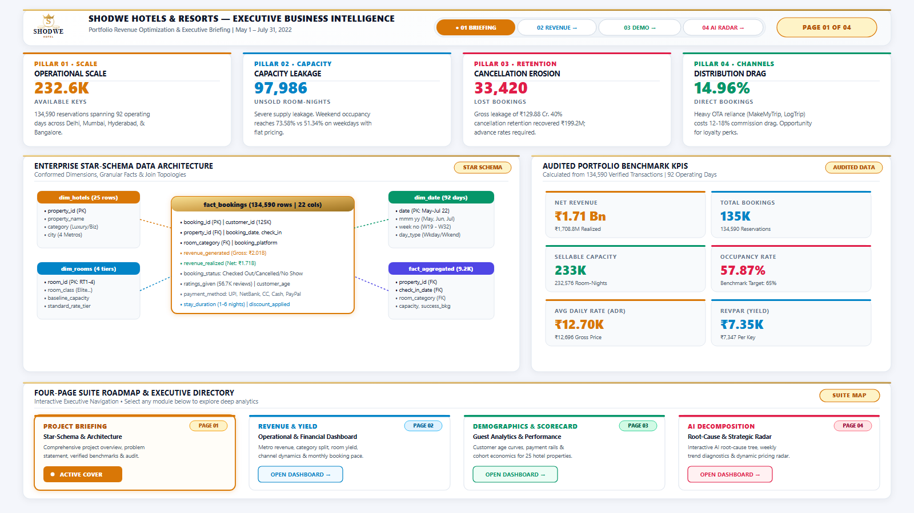
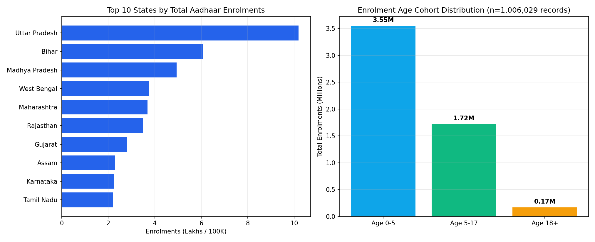
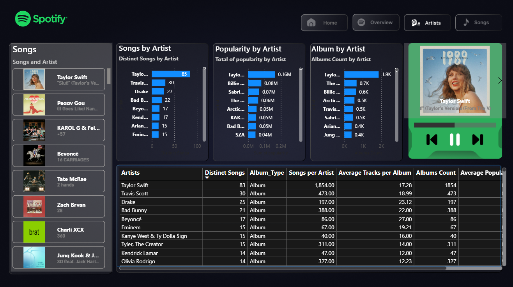
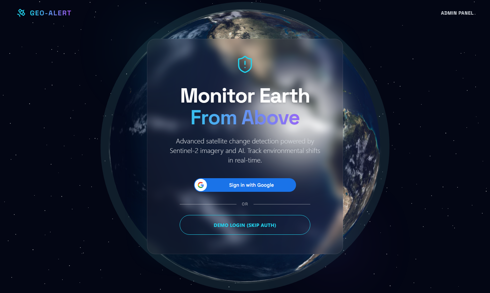
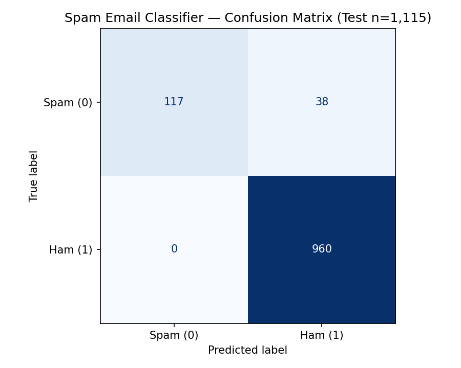

  <table>
    <tr>
      <td align="center" valign="middle" width="165">
        
      </td>
      <td valign="middle" align="left" style="padding-left: 20px;">
        <h1>Hi, I'm Yogesh Patil </h1>
        
         
        📍 <b>Pune, India</b> • 💼 <b>Data Analyst Intern @ AI Variant (Apr – Oct 2026)</b> • 🥇 <b>NASSCOM Gold Certified (83%)</b> • 💻 <b>B.E. Computer Engineering</b>
      </td>
    </tr>
  </table>

   

  
  
  
  

    

  <table>
    <tr>
      <td align="center">
        <i>"Turning multi-million-row operational records into dimensional Star Schemas, decision-ready Power BI &amp; Tableau suites, and reproducible Python ML pipelines."</i>
      </td>
    </tr>
  </table>

---

### 👤 Executive Summary

Computer Engineering graduate (**B.E. Computer Engineering, SPPU, Jul 2026**) and **Data Analyst & BI Developer** with hands-on experience across **MySQL**, **Power BI (DAX, Power Query)**, **Tableau**, **Advanced Excel**, and **Python (Pandas, NumPy, Scikit-learn, Plotly)**.

Backed by corporate & industry training—including a 6-month **Data Analyst Internship at AI Variant (Apr – Oct 2026)**, **Data Management Executive experience at Jowali Foods Pvt. Ltd. (Sep 2024 – Nov 2025)**, **Microsoft Elevate & AICTE Emerging Technologies (Power BI & Azure)**, and a **MeitY / NASSCOM FutureSkills Prime Gold Certification (83%, NSQF Level 5)**—I build clean, auditable analytical systems from raw ingestion to executive insight. Actively seeking full-time **Data Analyst**, **BI Developer**, or **AI/Data Associate** roles.

---

### 🛠️ Core Competencies & Tech Stack

<table>
  <tr>
    <td width="26%" valign="top"><b>📊 Business Intelligence &amp; Analytics</b></td>
    <td width="74%">
      
      
      
      
      
      
       
      Executive Dashboards • Multi-Fact Star Schemas • KPI Architecture (ADR, RevPAR, Margin) • Cohort Analysis • Decomposition Trees
    </td>
  </tr>
  <tr>
    <td width="26%" valign="top"><b>🗄️ Databases &amp; SQL Engineering</b></td>
    <td width="74%">
      
      
      
       
      Common Table Expressions (<code>WITH</code>) • Window Functions (<code>DENSE_RANK</code>, <code>RANK</code>, <code>LAG</code>) • Reusable Views • Stored Procedures &amp; Triggers
    </td>
  </tr>
  <tr>
    <td width="26%" valign="top"><b>🐍 Python, Data Science &amp; ML</b></td>
    <td width="74%">
      
      
      
      
      
      
       
      Multi-Shard CSV ETL • Exploratory Data Analysis (EDA) • TF-IDF NLP Classification • Confusion Matrix &amp; F1 Diagnostics • <code>unittest</code>
    </td>
  </tr>
  <tr>
    <td width="26%" valign="top"><b>⚙️ Full-Stack, Geospatial &amp; Workflow</b></td>
    <td width="74%">
      
      
      
      
      
      
       
      REST APIs • Satellite Remote Sensing (Sentinel-2 / Earth Engine) • Automated Testing &amp; CI Workflows • Clean Git History
    </td>
  </tr>
</table>

---

### 🚀 Visual Flagship Project Portfolio

#### 🥇 Tier 1: Enterprise Business Intelligence & Multi-Million-Row Analytics

<table>
  <tr>
    <td width="50%" valign="top">
      
      <h3>🏨 Shodwe Hotels &amp; Resorts — Hospitality BI</h3>
      

        
        
        
        
      

      
4-page executive BI suite evaluating <b>₹1.71 Bn realized revenue</b> across <b>134,590 bookings</b> and 25 metro hotel properties to uncover cancellation leakage and weekend yield gaps.

      

        
<b>🔍 Click to View Star-Schema &amp; Audited KPIs</b>

        <ul>
          <li><b>Data Model:</b> <code>fact_bookings</code> (134,590 rows) + <code>fact_aggregated_bookings</code> (9,200) joined to <code>dim_hotels</code>, <code>dim_rooms</code>, and <code>dim_date</code>.</li>
          <li><b>Audited KPIs:</b> Occupancy <code>57.87%</code> (<code>73.58%</code> weekend vs <code>51.34%</code> weekday), ADR <code>₹12.70K</code>, RevPAR <code>₹7.35K</code>, Cancellation <code>24.83%</code>.</li>
          <li><b>Deliverables:</b> 4-page Power BI report (with AI Decomposition Tree), Tableau workbook, exported PDF dossier, and MySQL validation checks.</li>
        </ul>
      

      
<a href="https://github.com/yogesh-patil2003/Shodwe-Hotels-Hospitality-BI"><b>👉 Explore Shodwe Hotels BI →</b></a>

    </td>
    <td width="50%" valign="top">
      
      <h3>🇮🇳 UIDAI Aadhaar National Analytics (4.94M Rows)</h3>
      

        
        
        
        
      

      
Multi-shard Python Pandas &amp; Plotly EDA pipeline ingesting <b>4,938,837 Aadhaar records</b> across 12 CSV files (Biometric, Demographic &amp; Enrolment) for regional and age-cohort insights.

      

        
<b>🔍 Click to View Dataset Scale &amp; Data Quality Findings</b>

        <ul>
          <li><b>Verified Volume:</b> <code>1,861,108</code> Biometric + <code>2,071,700</code> Demographic + <code>1,006,029</code> Enrolment rows.</li>
          <li><b>Cohort Insights:</b> Child enrolments (0–5 yrs) account for <code>3.55M (65.25%)</code>; Uttar Pradesh leads at <code>1.02M</code> enrolments.</li>
          <li><b>Engineering:</b> Reproducible CLI script, cleaned Jupyter notebooks, and GitHub Actions validation.</li>
        </ul>
      

      
<a href="https://github.com/yogesh-patil2003/UIDAI-Aadhaar-Analytics"><b>👉 Explore UIDAI Analytics →</b></a>

    </td>
  </tr>
  <tr>
    <td width="50%" valign="top">
      
      <h3>📦 Sustainable Supply Chain Star-Schema BI</h3>
      

        
        
        
      

      
Multi-fact <b>9-table Star Schema (24,612 rows)</b> monitoring supplier procurement lead times, factory defect rates, safety-stock reorder thresholds, and carrier freight delays.

      

        
<b>🔍 Click to View 5 Fact &amp; 4 Dimension Tables</b>

        <ul>
          <li><b>Facts (23,852 rows):</b> <code>fact_sales</code> (8,500), <code>fact_shipment</code> (7,500), <code>fact_production</code> (4,500), <code>fact_procurement</code> (2,200), <code>fact_inventory</code> (1,152).</li>
          <li><b>Dimensions (760 rows):</b> <code>dim_date</code> (731), <code>dim_product</code> (16), <code>dim_supplier</code> (7), <code>dim_facility</code> (6).</li>
        </ul>
      

      
<a href="https://github.com/yogesh-patil2003/Sustainable-Supply-Chain-Performance-Dashboard"><b>👉 Explore Supply Chain BI →</b></a>

    </td>
    <td width="50%" valign="top">
      
      <h3>🎵 Interactive Spotify Top 50 Power BI Suite</h3>
      

        
        
        
      

      
Dark-themed 3-page Power BI analytics dashboard examining <b>27,800 Spotify Top 50 tracks</b> for artist dominance, album formats, explicit-content share, and popularity trends.

      

        
<b>🔍 Click to View Dashboard Tabs &amp; DAX Highlights</b>

        <ul>
          <li><b>3 Interactive Views:</b> Executive Overview, Artist Scorecard, and Track-Level Explorer.</li>
          <li><b>DAX Logic:</b> Dynamic <code>CALCULATE</code>, <code>DISTINCTCOUNT</code>, and <code>DIVIDE</code> explicit track share measures.</li>
        </ul>
      

      
<a href="https://github.com/yogesh-patil2003/Interactive-Spotify-Analytics-Dashboard-using-Power-BI"><b>👉 Explore Spotify Analytics →</b></a>

    </td>
  </tr>
</table>

---

#### 🥈 Tier 2: Geospatial AI, NLP Machine Learning & SQL Engineering

<table>
  <tr>
    <td width="50%" valign="top">
      
      <h3>🛰️ GeoAlert — Satellite Change &amp; NDVI Alerting</h3>
      

        
        
        
        
      

      
Team capstone geospatial platform combining <b>ESA Copernicus Sentinel-2</b>, <b>Google Earth Engine</b>, OpenCV differencing, and an interactive Three.js / Leaflet UI with automated SMTP environmental alerts.

      

        <a href="https://geo-alert-ten.vercel.app/"><b>🌐 Live App</b></a> •
        <a href="https://github.com/yogesh-patil2003/GeoAlert"><b>💻 Explore Repository →</b></a>
      

    </td>
    <td width="50%" valign="top">
      
      <h3>🛡️ Spam Email Detection NLP Classifier</h3>
      

        
        
        
        
      

      
Supervised NLP binary classifier trained on <b>5,572 messages</b> using TF-IDF &amp; Logistic Regression achieving <b>~96.6% test accuracy</b> and <b>1.00 spam precision</b> (0 false positives on ham), complete with CLI tool, <code>unittest</code> suite, and GitHub Actions CI.

      
<a href="https://github.com/yogesh-patil2003/Spam-Email-Detection-Model"><b>💻 Explore ML Code &amp; Tests →</b></a>

    </td>
  </tr>
</table>

#### 🥉 Additional Verified Engineering & BI Workbenches

| Repository | Verified Scope & Technical Focus | Primary Stack |
| :--- | :--- | :--- |
| [**AdventureWorks**](https://github.com/yogesh-patil2003/AdventureWorks) | End-to-end BI workbench across **60,398 sales records** featuring MySQL views, `WITH` CTEs, `DENSE_RANK()`, Excel, Power BI, and Tableau deliverables. | `MySQL` · `Power BI` · `Tableau` · `Excel` |
| [**Manufacturing-Operations-BI**](https://github.com/yogesh-patil2003/Manufacturing-Operations-BI) | **9-table, 31,991-row Star Schema** Power BI operations suite covering `10,679` production runs, `86` machines, rejections, and KPI specs. | `Power BI` · `DAX` · `Star Schema` |
| [**weather-app**](https://github.com/yogesh-patil2003/weather-app) | Responsive browser geolocation weather app with 5-min auto-refresh & `localStorage` client-side OpenWeatherMap key prompt ([Live](https://yogesh-patil2003.github.io/weather-app/)). | `JavaScript` · `HTML5` · `CSS3` |
| [**CODSOFT**](https://github.com/yogesh-patil2003/CODSOFT) | Core C++17 console engineering projects verified via automated GitHub Actions `g++` compilation CI. | `C++17` · `GitHub Actions` |

---

### 📐 End-to-End Analytics Workflow

---

### 📈 Verified Portfolio Footprint

  <table>
    <tr>
      <td align="center" width="25%">
        <h3>📊 4.94M+</h3>
        <b>Aadhaar Rows Processed</b> 12 Multi-Shard CSV Datasets
      </td>
      <td align="center" width="25%">
        <h3>🏨 ₹1.71 Bn</h3>
        <b>Hospitality Revenue Audited</b> 134,590 Bookings · 25 Hotels
      </td>
      <td align="center" width="25%">
        <h3>🛍️ 60,398</h3>
        <b>AdventureWorks Sales Rows</b> MySQL Views, CTEs &amp; Windows
      </td>
      <td align="center" width="25%">
        <h3>📦 24,612</h3>
        <b>Supply Chain Star Schema</b> 5 Fact + 4 Dimension Tables
      </td>
    </tr>
    <tr>
      <td align="center">
        <h3>📈 10+</h3>
        <b>BI Dashboards Built</b> Power BI, Tableau &amp; Excel
      </td>
      <td align="center">
        <h3>🛡️ 96.6%</h3>
        <b>NLP Classifier Accuracy</b> 5,572 Emails · 1.00 Spam Prec.
      </td>
      <td align="center">
        <h3>🥇 83% Gold</h3>
        <b>NASSCOM Data Analyst</b> NSQF Level 5 · ExcelR 90% FAT
      </td>
      <td align="center">
        <h3>✅ 4 / 4</h3>
        <b>Green CI Workflows</b> GitHub Actions Verified
      </td>
    </tr>
  </table>

---

### 🎓 Education & Verified Credentials

<table>
  <tr>
    <td width="50%" valign="top">
      <h4>🎓 Education &amp; Internships</h4>
      <ul>
        <li><b>B.E. Computer Engineering</b> — SRTTC Pune, SPPU (Nov 2022 – Jul 2026 · CGPA <code>7.62</code>, First Class)</li>
        <li><b>Data Analyst Intern</b> — AI Variant (Apr – Oct 2026)</li>
        <li><b>Data Management Executive</b> — Jowali Foods Pvt. Ltd., Pune (Sep 2024 – Nov 2025)</li>
        <li><b>Emerging Technologies Intern (Power BI &amp; Azure)</b> — Microsoft Elevate &amp; AICTE (Feb – Mar 2026)</li>
        <li><b>Foundations of AI Intern</b> — Microsoft, Edunet Foundation &amp; AICTE (Apr – May 2025)</li>
      </ul>
    </td>
    <td width="50%" valign="top">
      <h4>🏅 Key Industry Certifications</h4>
      <ul>
        <li>🥇 <b>MeitY &amp; NASSCOM FutureSkills Prime:</b> Data Analyst — <b>Gold Category (83%)</b>, NSQF Level 5 (Oct 2026)</li>
        <li>📜 <b>ExcelR Solutions:</b> Data Analyst Certification Program — <b>90% FAT Exam</b> (Jul 2026)</li>
        <li>🗄️ <b>HackerRank:</b> SQL (Basic) Certified (Jan 2026) · <b>Infosys Springboard:</b> SQL Developer</li>
        <li>🐍 <b>Cisco Networking Academy:</b> Python Essentials 1 &amp; 2 (Jan – Feb 2026)</li>
        <li>📊 <b>Google Skillshop:</b> Google Analytics for Beginners (Valid to Feb 2027)</li>
      </ul>
    </td>
  </tr>
</table>

---

### 📈 GitHub Activity

  
  

---

### 📬 Connect & Collaborate

- 💼 **LinkedIn:** [linkedin.com/in/yogeshpatil2003](https://www.linkedin.com/in/yogeshpatil2003/)
- 📧 **Email:** [officialyogeshpatil0@gmail.com](mailto:officialyogeshpatil0@gmail.com)
- 📍 **Location:** Pune, Maharashtra, India *(Open to Full-Time, Remote & Relocation)*

  Designed &amp; maintained by Yogesh Anil Patil • Data Analyst &amp; BI Developer

